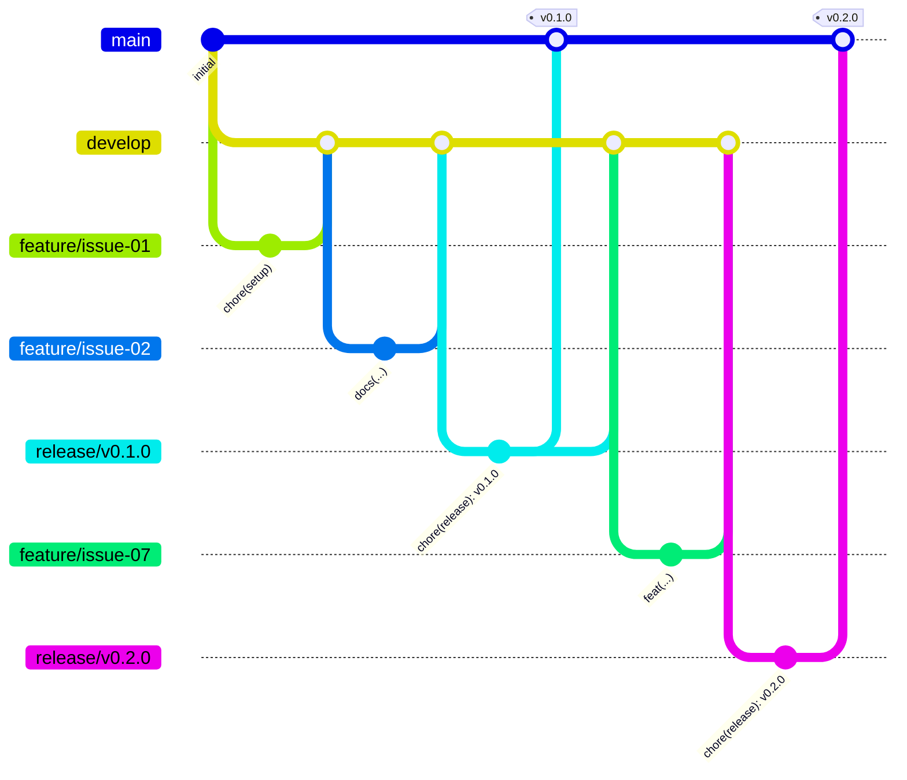

# HabitFlow — Gerenciador de Hábitos e Consistência Diária

[](https://github.com/gabresantts/habitflow/releases)
[](./LICENSE)
[](https://github.com/gabresantts/habitflow/actions/workflows/ci.yml)
[](https://gabresantts.github.io/habitflow/)


## Resumo da Solução e Stack Tecnológica:

O **HabitFlow** é uma aplicação web full-stack (API RESTful + Dashboard Web Interativo) projetada para auxiliar estudantes e profissionais na construção e manutenção de hábitos diários. O software soluciona a falta de visibilidade comportamental ao oferecer cadastro estruturado de metas, registro de check-in com apenas um clique, cálculo matemático rigoroso de sequências ativas (current streak e recorde histórico) e consolidação diária da taxa de conclusão. A aplicação possui arquitetura desacoplada com costura de execução (execution seam): no ambiente de servidor opera via API HTTP com persistência atômica em arquivo JSON, enquanto no GitHub Pages opera em modo demonstração client-side via interceptor de rotas no localStorage do navegador, permitindo deploy estático sem custo de servidor e compatibilidade com Vercel.

O desenvolvimento aplicou integralmente o **Ciclo de Vida de Desenvolvimento de Software (SDLC)**: Termo de Abertura (Project Charter com metas SMART e delimitação de escopo), Engenharia de Requisitos (8 RFs e 6 RNFs com Matriz de Rastreabilidade), Casos de Uso (UC01 a UC05 com diagramas Mermaid), Histórias de Usuário canônicas com critérios de aceitação em BDD/Gherkin (Dado/Quando/Então), diagramas complementares (C4 Model, Diagrama de Classes e Máquina de Estados), backlog desdobrado em 15 GitHub Issues, fluxo de trabalho Git Flow (branches temáticas e merges rastreáveis), Conventional Commits e controle de versão SemVer com suíte de 41 testes automatizados (100% aprovados).

## Demonstração Online

**https://gabresantts.github.io/habitflow/**

O GitHub Pages só serve arquivos estáticos, então a versão publicada roda em **modo demonstração**: o mesmo `HabitService`, o mesmo roteador da API e o mesmo cálculo de *streaks* do backend são carregados no navegador, e um `fetch` substituto encaminha as chamadas `/api/*` para eles. Os dados ficam no `localStorage` de quem acessa, sem servidor. Para usar a API Node com persistência em `data/habits.json`, siga a execução local abaixo.

---

## Documentação de Engenharia (`docs/`)

Todos os artefatos formais de especificação e modelagem encontram-se na pasta `docs/`:

| Documento | Descrição | Link Direto |
| :--- | :--- | :--- |
| **Project Charter** | Justificativa, visão do produto, objetivos SMART, escopo (In/Out) e Stakeholders. | [`docs/project-charter.md`](./docs/project-charter.md) |
| **Requisitos (RF e RNF)** | Lista numerada e rastreável de 8 Requisitos Funcionais e 6 Requisitos Não Funcionais + Matriz de Rastreabilidade. | [`docs/requisitos.md`](./docs/requisitos.md) |
| **Casos de Uso** | Especificação de atores, diagrama Mermaid e fluxos principais, alternativos e de exceção (`UC01` a `UC05`). | [`docs/casos-de-uso.md`](./docs/casos-de-uso.md) |
| **User Stories (BDD)** | 5 Histórias de Usuário no formato canônico com Critérios de Aceite explícitos em Gherkin (*Dado/Quando/Então*). | [`docs/user-stories.md`](./docs/user-stories.md) |
| **Arquitetura e Diagramas** | Diagrama C4 de Componentes, Diagrama de Classes, Máquina de Estados de *Streaks* e Especificação da API REST. | [`docs/arquitetura-e-diagramas.md`](./docs/arquitetura-e-diagramas.md) |

---

## Sumário de Funcionalidades: Implementadas vs. Planejadas

| Funcionalidade | Requisito | Status | Versão |
| :--- | :---: | :---: | :---: |
| Cadastro de hábitos com validação de título, categoria e meta semanal | `RF01`, `RF08` | Implementado | `v0.2.0` |
| Listagem e filtragem dinâmica por categoria, status do dia e busca textual | `RF02` | Implementado | `v0.2.0` |
| Edição de hábitos existentes preservando histórico e exclusão permanente | `RF03`, `RF04` | Implementado | `v0.2.0` |
| Registro de *check-in* diário (*toggle* concluído/pendente por data ISO) | `RF05` | Implementado | `v0.2.0` |
| Cálculo automático de ofensiva atual (*current streak*) e recorde (*best streak*) | `RF06`, `RF07` | Implementado | `v0.2.0` |
| Dashboard web responsivo com cartões de estatísticas e barra de progresso | `RF07`, `RNF03` | Implementado | `v1.0.0` |
| Suíte de testes automatizados (unitários e integração HTTP) e CI no GitHub Actions | `RNF05` | Implementado | `v1.0.0` |
| Modo demonstração no GitHub Pages com dados no `localStorage` do navegador | `RNF03`, `RNF06` | Implementado | `v1.1.0` |
| Autenticação multiusuário com JWT / OAuth2 | Backlog Futuro | Planejado | `v2.0.0` |
| Notificações push / lembretes por e-mail e WhatsApp | Backlog Futuro | Planejado | `v2.1.0` |
| Exportação de relatórios mensais em PDF/CSV | Backlog Futuro | Planejado | `v2.2.0` |

---

## Estrutura do Repositório

```text
habitflow/
├── docs/
│   ├── project-charter.md           # Termo de Abertura do Projeto (SMART, Escopo, Stakeholders)
│   ├── requisitos.md                # Requisitos Funcionais (RF01-RF08) e Não Funcionais (RNF01-RNF06)
│   ├── casos-de-uso.md              # Especificação de Casos de Uso (UC01-UC05)
│   ├── user-stories.md              # Histórias de Usuário (US01-US05) com Critérios BDD/Gherkin
│   └── arquitetura-e-diagramas.md   # Diagramas C4, Classes, Estados e Endpoints REST
├── src/
│   ├── public/                      # Interface Web Responsiva (HTML5, CSS3, JS Client)
│   │   ├── index.html
│   │   ├── styles.css
│   │   └── app.client.js
│   ├── api/
│   │   └── router.js                # Rotas /api/* como função pura (usada pelo servidor e pelo modo demo)
│   ├── services/
│   │   └── habitService.js          # Regras de negócio e validações (recebe o adapter de armazenamento)
│   ├── storage/
│   │   ├── jsonFileStorage.js       # Adapter de armazenamento em data/habits.json (Node)
│   │   └── localStorageStorage.js   # Adapter de armazenamento no localStorage (navegador)
│   ├── demo/
│   │   ├── boot.js                  # Carrega os módulos no navegador e substitui o fetch de /api/*
│   │   └── demoFetch.js             # Encaminha chamadas /api/* para o roteador
│   ├── utils/
│   │   └── streakCalculator.js      # Motor matemático de cálculo de streaks e datas
│   ├── app.js                       # Servidor HTTP: CORS, leitura do corpo e arquivos estáticos
│   └── server.js                    # Ponto de entrada da aplicação
├── scripts/
│   └── build-pages.sh               # Monta o site do modo demonstração em _site/
├── tests/
│   ├── habit.test.js                # Testes automatizados (Unitários + API REST)
│   └── demo.test.js                 # Testes do modo demonstração e do adapter do navegador
├── data/
│   └── .gitkeep                     # Diretório de persistência local (habits.json)
├── .github/workflows/ci.yml         # Pipeline de CI (npm test em Node 20 e 22)
├── .github/workflows/pages.yml      # Testa, monta e publica o modo demonstração no GitHub Pages
├── .gitignore                       # Arquivos e pastas ignorados pelo Git
├── LICENSE                          # Licença MIT
├── package.json                     # Manifesto do projeto e scripts npm
└── README.md                        # Documentação principal e guia do projeto
```

---

## Configuração de Ambiente, Instalação e Execução Local

### Pré-requisitos
- **Node.js** versão `18.0.0` ou superior instalado ([https://nodejs.org/](https://nodejs.org/)).
- **Git** instalado.

> **Portabilidade Total (`RNF06`):** O projeto usa apenas módulos nativos do Node.js (`node:http`, `node:fs`, `node:crypto`, `node:test`). Não há dependências npm nem banco de dados externo, então não é preciso rodar `npm install`.

### Passo a Passo

1. **Clone o repositório:**
   ```bash
   git clone https://github.com/gabresantts/habitflow.git
   cd habitflow
   ```

2. **Execute a suíte de testes automatizados:**
   ```bash
   npm test
   ```

3. **Inicie o servidor da aplicação:**
   ```bash
   npm start
   ```

4. **Acesse no navegador:**
   - **Dashboard Web Interativo:** `http://localhost:3000`
   - **Healthcheck da API:** `http://localhost:3000/api/health`
   - **Estatísticas JSON:** `http://localhost:3000/api/habits/stats`

---

## Fluxo de Branches Adotado (Git Flow) e Versionamento Semântico

O desenvolvimento segue o modelo **Git Flow** combinado com **Conventional Commits** e **SemVer**. Nenhum commit é feito direto em `main` ou `develop`: toda mudança entra por **Pull Request** que referencia a issue (`Closes #N`).

1. Cada issue ganha uma branch `feature/issue-NN-descricao` criada a partir de `develop`.
2. A branch volta para `develop` por Pull Request, depois do CI verde.
3. Num marco estável, uma branch `release/vX.Y.Z` sai de `develop`, atualiza a versão no `package.json` e é integrada em `main` por Pull Request.
4. O merge em `main` recebe uma **tag anotada** SemVer e uma Release no GitHub; a branch de release volta para `develop`.



### Tabela de Branches e Releases

| Branch / Tag | Tipo | Objetivo e Rastreabilidade |
| :--- | :---: | :--- |
| `main` | Produção | Contém apenas código estável, integrado por Pull Request de uma branch `release/*` e marcado com tag SemVer. |
| `develop` | Integração | Branch base de desenvolvimento onde todas as branches `feature/issue-*` são integradas por Pull Request. |
| `release/vX.Y.Z` | Release | Atualiza a versão no `package.json` e leva `develop` para `main`. |
| `feature/issue-01-setup-projeto` | Feature/Chore | Configuração inicial da estrutura de pastas, `.gitignore` e `package.json` (`Closes #1`). |
| `feature/issue-02-project-charter` | Docs | Elaboração do Termo de Abertura do Projeto (`Closes #2`). |
| `feature/issue-03-requisitos` | Docs | Especificação dos Requisitos Funcionais e Não Funcionais (`Closes #3`). |
| `feature/issue-04-casos-de-uso` | Docs | Modelagem dos Casos de Uso `UC01` a `UC05` (`Closes #4`). |
| `feature/issue-05-user-stories` | Docs | Escrita das Histórias de Usuário em BDD/Gherkin (`Closes #5`). |
| `feature/issue-06-arquitetura-diagramas` | Docs | Diagramas C4, Classes e Estados em Mermaid (`Closes #6`). |
| `feature/issue-07-api-cadastro-habito` | Feature | Implementação do cadastro e validação de hábitos `[RF01, RF08]` (`Closes #7`). |
| `feature/issue-08-api-listagem-filtro` | Feature | Listagem de hábitos com filtro por categoria, status e busca `[RF02]` (`Closes #8`). |
| `feature/issue-09-api-edicao-exclusao` | Feature | Endpoints e regras de edição e exclusão de hábitos `[RF03, RF04]` (`Closes #9`). |
| `feature/issue-10-api-checkin-diario` | Feature | Registro e alternância (*toggle*) de *check-in* por data `[RF05]` (`Closes #10`). |
| `feature/issue-11-calculo-streaks` e `feature/issue-11-estatisticas-dashboard` | Feature | Algoritmo de cálculo de ofensivas (*streaks*) e endpoint de estatísticas `[RF06, RF07]` (`Refs #11` / `Closes #11`). |
| `feature/issue-12-persistencia-json` | Feature | Camada de persistência automática em arquivo JSON e *seed* inicial `[RNF02]` (`Closes #12`). |
| `feature/issue-13-interface-web-dashboard` | Feature | Construção do Frontend responsivo consumindo a API `[RNF03]` (`Closes #13`). |
| `feature/issue-14-testes-integracao-ci` | Test | Testes de integração HTTP e pipeline de CI no GitHub Actions `[RNF05]` (`Closes #14`). |
| `feature/issue-15-readme-documentacao-final` | Docs | Consolidação do `README.md`, badges, guia de execução e revisão final (`Closes #15`). |

### Histórico de Releases (SemVer)
- **`v0.1.0`** — *Milestone 1: Especificação e Documentação de Engenharia Completa* (Issues `#1` a `#6`).
- **`v0.2.0`** — *Milestone 2: Core Backend API REST, Persistência e Cálculo de Streaks* (Issues `#7` a `#12`).
- **`v1.0.0`** — *Milestone 3: Release Final MVP com Dashboard Web e Testes Automatizados* (Issues `#13` a `#15`).
- **`v1.0.1`** — *Patch de documentação: remoção de emojis do README* (Issue `#38`).
- **`v1.0.2`** — *Patch de documentação: correção da referência de issue da v1.0.1* (Issue `#38`).
- **`v1.1.0`** — *Modo demonstração no GitHub Pages: adapter de armazenamento, roteador da API extraído e deploy automático* (Issues `#45` e `#46`).
- **`v1.1.1`** — *Patch de documentação: arquitetura e diagramas atualizados* (Issue `#51`).
- **`v1.1.2`** — *Patch de documentação: remoção de emojis dos documentos de `docs/`* (Issue `#55`).
- **`v1.2.0`** — *Redesign da interface: tema escuro sóbrio, ícones SVG, check-in acessível e layout responsivo* (Issue `#59`).
