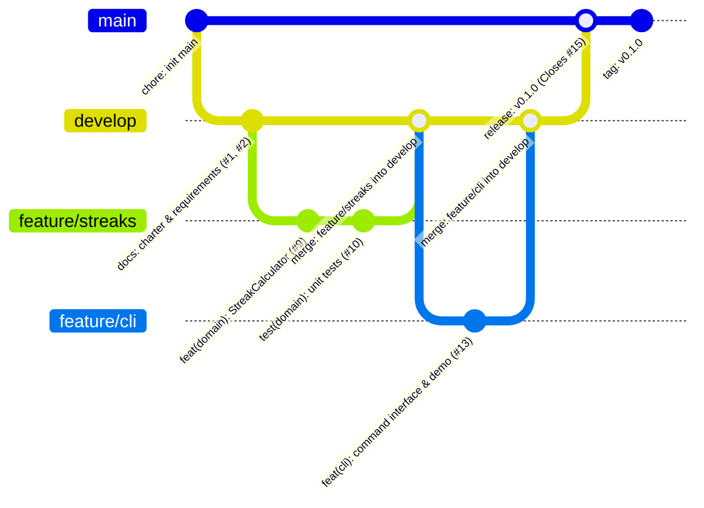

# 🌊 HabitFlow - Gerenciador Inteligente de Hábitos & SDLC no GitHub

[](https://semver.org)
[](LICENSE)
[](tests/)
[](package.json)
[](docs/backlog-issues.md)
[](https://www.conventionalcommits.org)

> **HabitFlow** é uma solução de engenharia para gestão de hábitos diários, cálculo contínuo de sequências (*streaks*), métricas de adesão semanal e produtividade pessoal. Desenvolvido com foco rigoroso em boas práticas de Engenharia de Software, arquitetura em camadas (Clean Architecture), persistência atômica e rastreabilidade total no GitHub (Git Flow, Conventional Commits e GitHub Issues).

---

## 📑 Sumário

- [Visão Geral e Problema Resolvido](#-visão-geral-e-problema-resolvido)
- [Funcionalidades: Implementadas vs. Planejadas](#-funcionalidades-implementadas-vs-planejadas)
- [Arquitetura e Estrutura do Repositório](#-arquitetura-e-estrutura-do-repositório)
- [Documentação de Engenharia (Pasta docs/)](#-documentação-de-engenharia-pasta-docs)
- [Backlog no GitHub: As 15 Issues](#-backlog-no-github-as-15-issues)
- [Fluxo de Trabalho de Versionamento (Git Flow)](#-fluxo-de-trabalho-de-versionamento-git-flow)
- [Guia de Instalação e Execução Local](#-guia-de-instalação-e-execução-local)
- [Bateria de Testes Automatizados](#-bateria-de-testes-automatizados)
- [Licença e Autoria](#-licença-e-autoria)

---

## 🎯 Visão Geral e Problema Resolvido

A inconsistência na manutenção de hábitos saudáveis e rotinas de estudo decorre frequentemente da ausência de feedback imediato e da falta de métricas tangíveis de progresso. O **HabitFlow** resolve este problema fornecendo:

1. **Rastreamento Intuitivo**: Registro diário ágil com status claro (Pendente vs. Concluído).
2. **Psicologia de Streaks**: Algoritmo matemático para cálculo de dias consecutivos ininterruptos (*current streak*) e recorde histórico (*longest streak*).
3. **Métricas de Adesão**: Cálculo de consistência percentual nos últimos 7 e 30 dias.
4. **Persistência Durável**: Escrita atômica em disco (*atomic write*) eliminando qualquer risco de corrupção de dados.

---

## 🚀 Funcionalidades: Implementadas vs. Planejadas

| Status | Funcionalidade | Descrição | Requisito / Issue |
| :---: | :--- | :--- | :--- |
| ✅ | **Cadastro de Hábitos** | Criação com título, categoria temática e meta semanal de dias (1-7). | `[RF01]` / #07, #11 |
| ✅ | **Acompanhamento de Streaks** | Cálculo de sequências ativas e recordes históricos em tempo real. | `[RF07]` / #09, #10 |
| ✅ | **Check-in Diário** | Registro de cumprimento diário com prevenção contra duplicidade. | `[RF05]` / #07, #12 |
| ✅ | **Desfazer Check-in (Undo)** | Reversão de marcações acidentais com recálculo de sequências. | `[RF06]` / #12 |
| ✅ | **Arquivamento (Soft Delete)** | Ocultar hábitos concluídos ou suspensos preservando o histórico. | `[RF04]` / #11 |
| ✅ | **Filtragem por Categorias** | Segmentação por Saúde, Estudos, Produtividade, etc. | `[RF08]` / #11 |
| ✅ | **Relatório Analítico & Métricas** | Relatório executivo com taxas de consistência e hábitos recordistas. | `[RF09]` / #14 |
| ✅ | **Interface CLI & Modo Demonstração** | Execução rápida no terminal e gerador de massa de testes de 7 dias. | `[RNF03]` / #13 |
| ✅ | **Persistência Atômica Durável** | Gravação segura via arquivo temporário + renomeação síncrona. | `[RNF02]` / #08 |
| ⏳ | **Autenticação Multi-usuário (OAuth2)** | Login via Google/GitHub com segregação de dados por usuário. | *Planejado (v0.2.0)* |
| ⏳ | **Interface Web Responsiva** | Frontend moderno em React / Tailwind para visualização em dashboards. | *Planejado (v0.3.0)* |
| ⏳ | **Notificações Push / Lembretes** | Envio de avisos para hábitos pendentes no fim do dia. | *Planejado (v1.0.0)* |

---

## 📦 Arquitetura e Estrutura do Repositório

O projeto segue estritamente a estrutura solicitada, aplicando separação de preocupações (Clean Architecture):

```text
habitflow/
├── .github/
│   └── workflows/
│       └── ci.yml                       # Pipeline de Integração Contínua (CI)
├── docs/                                # Documentação de Planejamento e Engenharia
│   ├── project-charter.md               # Termo de Abertura do Projeto (SMART, Escopo)
│   ├── requisitos.md                    # Requisitos Funcionais (RF) e Não Funcionais (RNF)
│   ├── casos-de-uso.md                  # Especificação e Diagrama de Casos de Uso
│   ├── user-stories.md                  # Histórias de Usuário e Critérios BDD/Gherkin
│   ├── arquitetura.md                   # Diagramas C4 Model, DER, Classes e Estados
│   └── backlog-issues.md                # Especificação das 15 Issues do GitHub
├── scripts/
│   ├── create-issues.ps1                # Automação de criação das 15 issues via GitHub CLI (PowerShell)
│   ├── create-issues.sh                 # Automação de criação das 15 issues via GitHub CLI (Bash)
│   ├── setup-gitflow.ps1                # Inicialização e automação de Git Flow (PowerShell)
│   └── setup-gitflow.sh                 # Inicialização e automação de Git Flow (Bash)
├── src/                                 # Código-fonte da aplicação
│   ├── domain/                          # Camada de Domínio Puro
│   │   ├── entities/
│   │   │   ├── Habit.js                 # Entidade Habit
│   │   │   └── CheckIn.js               # Entidade CheckIn
│   │   └── services/
│   │       └── StreakCalculator.js      # Lógica matemática de sequências consecutivas
│   ├── infrastructure/                  # Camada de Infraestrutura e Persistência
│   │   └── storage/
│   │       └── JSONHabitRepository.js   # Repositório JSON durável com escrita atômica
│   ├── application/                     # Camada de Aplicação / Casos de Uso
│   │   └── services/
│   │       ├── HabitService.js          # Casos de uso de hábitos e check-ins
│   │       └── MetricsService.js        # Relatórios estatísticos e consolidações
│   ├── presentation/                    # Camada de Apresentação
│   │   └── cli.js                       # CLI rica formatada com tabelas e suporte a demo
│   └── index.js                         # Ponto de entrada executável (CLI runner)
├── tests/                               # Suíte de Testes Automatizados
│   └── unit/
│       ├── StreakCalculator.test.js     # Testes unitários do cálculo de sequências
│       └── HabitService.test.js         # Testes unitários das regras de negócio e serviços
├── .gitignore                           # Exclusão de dependências, dados locais e temporários
├── package.json                         # Configurações do projeto e scripts npm
└── README.md                            # Guia principal do projeto
```

---

## 📝 Documentação de Engenharia (Pasta docs/)

Acesse os documentos de planejamento e engenharia nos links diretos abaixo:

1. 📄 [**Project Charter (Termo de Abertura)**](docs/project-charter.md): Justificativa do produto, metas SMART, delimitação de escopo in/out e análise de stakeholders.
2. 📋 [**Especificação de Requisitos (RF e RNF)**](docs/requisitos.md): 10 Requisitos Funcionais (`RF01-RF10`), 8 Requisitos Não Funcionais (`RNF01-RNF08`) e Matriz de Rastreabilidade.
3. 🎯 [**Casos de Uso (Use Cases)**](docs/casos-de-uso.md): Mapeamento de atores, fluxos principais, alternativos e de exceção com diagrama Mermaid.
4. 📖 [**Histórias de Usuário (User Stories)**](docs/user-stories.md): 8 User Stories no padrão canônico com critérios de aceitação completos em formato BDD/Gherkin.
5. 🏛️ [**Especificação Arquitetural e Modelagem**](docs/arquitetura.md): Diagramas C4 Model (Contexto e Contêiner), DER, Diagrama de Classes e Máquina de Estados.
6. 🗂️ [**Backlog de 15 Issues Detalhadas**](docs/backlog-issues.md): Mapeamento formal de cada issue com descrição pronta para o GitHub.

---

## ⚙️ Backlog no GitHub: As 15 Issues

O backlog foi planejado de forma a refletir integralmente o ciclo de desenvolvimento (SDLC):

| # | Tipo | Título da Issue | Labels | Critérios / Rastreabilidade |
| :-: | :--- | :--- | :--- | :--- |
| **#01** | `docs` | [DOC] Elaborar Project Charter e Termo de Abertura do Projeto | `documentation` | Metas SMART, Escopo In/Out |
| **#02** | `docs` | [DOC] Especificar Requisitos Funcionais (RF) e Não Funcionais (RNF) | `documentation` | `[RF01-RF10]`, `[RNF01-RNF08]` |
| **#03** | `docs` | [DOC] Modelar Casos de Uso com Fluxos Principais e de Exceção | `documentation` | `UC01-UC06`, Diagrama Mermaid |
| **#04** | `docs` | [DOC] Detalhar Histórias de Usuário com Critérios de Aceite BDD/Gherkin | `documentation` | `US01-US08`, BDD Given/When/Then |
| **#05** | `docs` | [DOC] Criar Diagramas Complementares de Engenharia (C4, DER, Classes) | `documentation`, `enhancement` | C4 Model, DER, Classes, Estados |
| **#06** | `chore` | [CHORE] Configurar Estrutura de Pastas do Repositório, .gitignore e Package.json | `chore`, `setup` | Layout padrão do projeto |
| **#07** | `feat` | [FEAT] Implementar Entidades de Domínio Habit e CheckIn com Validações | `feature`, `domain` | `[RF01]`, `[RF05]`, `[RNF07]` |
| **#08** | `feat` | [FEAT] Implementar Repositório com Persistência Atômica Durável em JSON | `feature`, `infrastructure` | `[RNF02]`, Escrita Atômica |
| **#09** | `feat` | [FEAT] Implementar Algoritmo de Cálculo de Streaks e Consistência Temporal | `feature`, `domain` | `[RF07]`, `US03`, Sequências contíguas |
| **#10** | `test` | [TEST] Desenvolver Suíte de Testes Unitários para StreakCalculator e HabitService | `test` | `[RNF04]`, 100% testes passing |
| **#11** | `feat` | [FEAT] Implementar Serviços de Aplicação (HabitService - CRUD e Filtros) | `feature`, `application` | `[RF01-RF04]`, `[RF08]` |
| **#12** | `feat` | [FEAT] Implementar Registro de Check-in Diário e Operação de Desfazer Check-in | `feature`, `application` | `[RF05]`, `[RF06]`, Anti-duplicação |
| **#13** | `feat` | [FEAT] Desenvolver Interface de Linha de Comando (CLI) e Demonstração | `feature`, `ui` | `[RNF03]`, Comandos interativos |
| **#14** | `feat` | [FEAT] Desenvolver Geração de Relatórios Estatísticos e Métricas Semanais | `feature`, `analytics` | `[RF09]`, Taxa semanal e mensal |
| **#15** | `release` | [RELEASE] Consolidar README.md, Versionamento SemVer v0.1.0 e Documentação Final | `documentation`, `release` | Tag SemVer `v0.1.0` |

> 💡 **Automação disponível**: Para criar todas as 15 issues instantaneamente no seu repositório via GitHub CLI, execute `./scripts/create-issues.ps1` (Windows) ou `./scripts/create-issues.sh` (Linux/Mac).

---

## 🔀 Fluxo de Trabalho de Versionamento (Git Flow)

O projeto adota rigorosamente o modelo **Git Flow** aliado a **Commits Atômicos** baseados na especificação [Conventional Commits](https://www.conventionalcommits.org/):



### Regras do Fluxo
1. **`main`**: Branch de produção contendo apenas versões prontas e estáveis marcadas com tags SemVer (ex.: `v0.1.0`). Commits diretos são expressamente proibidos.
2. **`develop`**: Branch de integração contínua contendo as últimas features validadas.
3. **`feature/issue-XX-...`**: Branches temáticas temporárias abertas para resolver cada issue específica.
4. **Commits Atômicos e Rastreáveis**: Mensagens no padrão `tipo(escopo): descrição concisa (#issue)` (ex.: `feat(streaks): calcular sequências consecutivas (#9)`).
5. **Fechamento de Issues**: Pull Requests ou merges referenciam o fechamento formal (ex.: `Closes #9`).

---

## 💻 Guia de Instalação e Execução Local

### Pré-requisitos
- **Node.js** na versão 18 LTS ou superior (`node -v`).
- **Git** instalado (`git -v`).

### 1. Clonar o Repositório
```bash
git clone https://github.com/SEU-USUARIO/habitflow.git
cd habitflow
```

### 2. Executar a Aplicação (Sem dependências externas pesadas)
Como a aplicação utiliza o runtime moderno Node.js ESM nativo e biblioteca padrão, não há necessidade obrigatória de `npm install` para iniciar:

```bash
# Executar a demonstração guiada (popula hábitos de exemplo e histórico de 7 dias)
npm run demo

# Listar os hábitos ativos e o painel de streaks
npm start
```

### 3. Comandos Principais da CLI

```bash
# Cadastrar um novo hábito
npm run cli -- add "Ler 20 páginas" Estudos 7

# Listar hábitos filtrando por categoria
npm run cli -- list Saúde

# Registrar check-in no dia de hoje
npm run cli -- check <ID_DO_HABITO>

# Desfazer o check-in de hoje (uncheck)
npm run cli -- uncheck <ID_DO_HABITO>

# Exibir relatório executivo de métricas e taxa de adesão
npm run cli -- stats

# Arquivar um hábito (soft delete)
npm run cli -- archive <ID_DO_HABITO>
```

---

## 🧪 Bateria de Testes Automatizados

O HabitFlow conta com suíte abrangente de testes unitários executados com o test runner nativo do Node.js (`node:test`), garantindo execução ultrarrápida e confiabilidade total das regras de negócio (`RNF04`):

```bash
# Executar todos os testes unitários
npm test

# Executar testes com relatório detalhado de cobertura de código
npm run test:coverage
```

### Cenários Cobertos nos Testes
- ✅ Cálculo de *current streak* com dia de hoje concluído vs. pendente.
- ✅ Tolerância ao dia corrente sem quebrar a sequência anterior válida de ontem.
- ✅ Detecção de quebra de sequência com preservação intacta do *longest streak* histórico.
- ✅ Deduplicação e ordenação cronológica de timestamps UTC.
- ✅ Cálculo exato de taxas de consistência percentual em janelas temporais de 7 dias.
- ✅ Validações de domínio (títulos vazios, frequências inválidas).
- ✅ Prevenção contra check-in repetido no mesmo dia para o mesmo hábito.
- ✅ Operação de desfazer check-in e recálculo imediato.
- ✅ Isolamento de hábitos arquivados (*soft delete*).

---

## 📄 Licença e Autoria

Distribuído sob a licença **MIT**. Consulte o arquivo `LICENSE` para mais detalhes.

Desenvolvido para a atividade prática de **Especificação, Gestão com Issues e SDLC no GitHub**.
