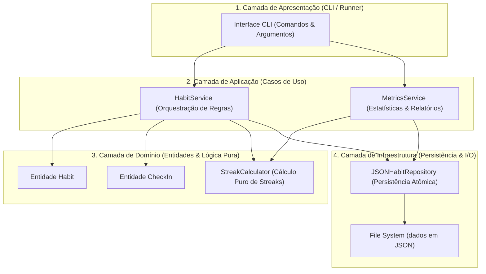
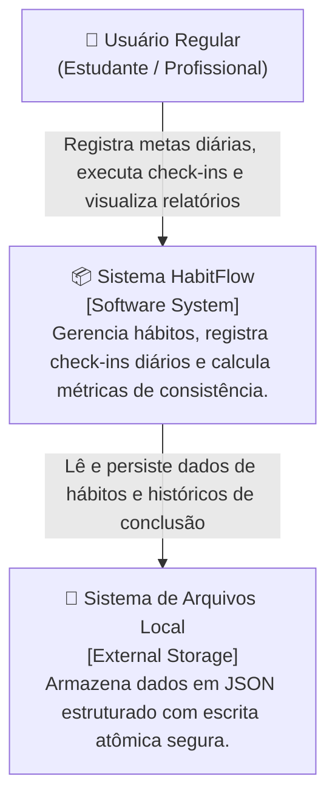
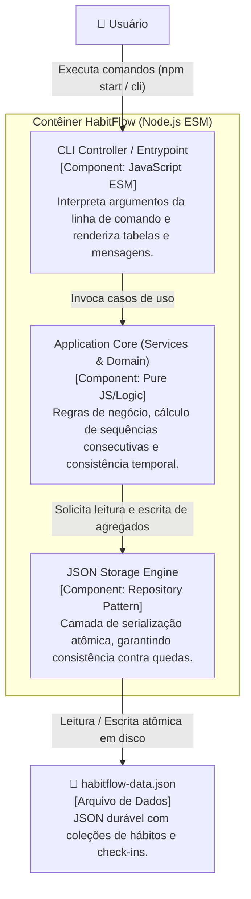
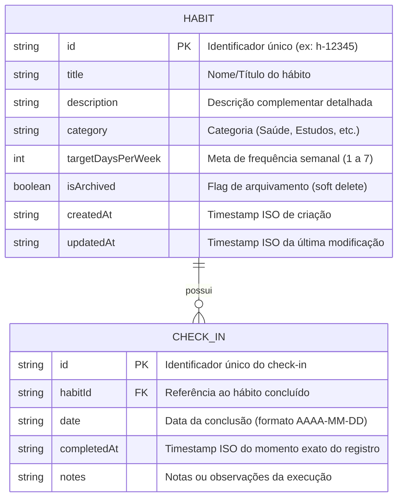
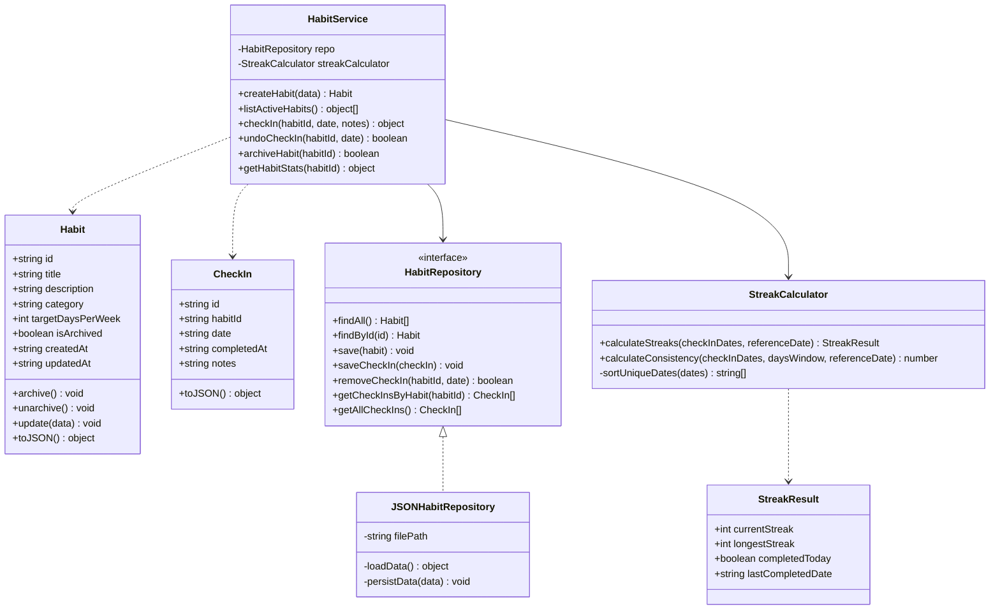
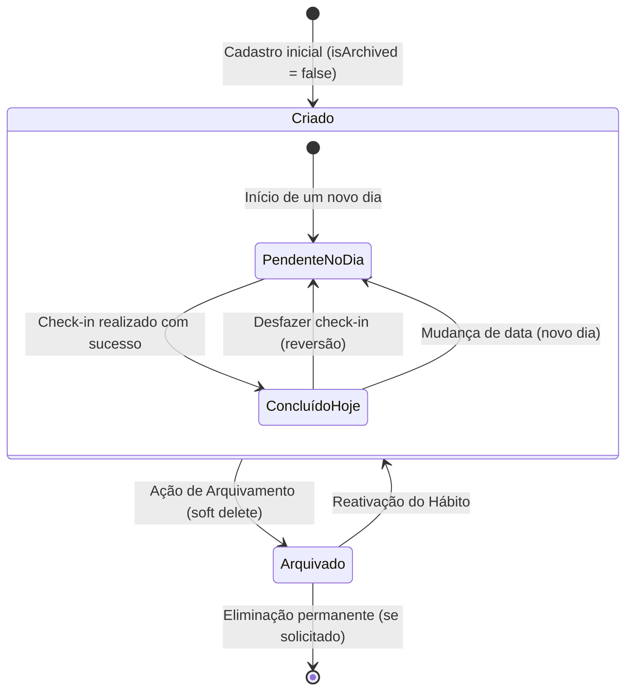

# HabitFlow - Especificação Arquitetural e Modelagem de Engenharia

Este documento consolida a arquitetura de software, diagramas conceituais (C4 Model), modelo de dados (DER), diagrama de classes e a máquina de estados do **HabitFlow**.

---

## 1. Visão Geral da Arquitetura (Clean Architecture & Layered Pattern)

O HabitFlow adota os princípios da Clean Architecture (Arquitetura Limpa), separando rigorosamente as preocupações em camadas concêntricas e unidirecionais:

---

## 2. Diagramas C4 Model

### 2.1. C4 Nível 1 - Diagrama de Contexto de Sistema

### 2.2. C4 Nível 2 - Diagrama de Contêineres

---

## 3. Modelo Entidade-Relacionamento (DER)

---

## 4. Diagrama de Classes UML

---

## 5. Máquina de Estados do Ciclo de Vida de um Hábito

