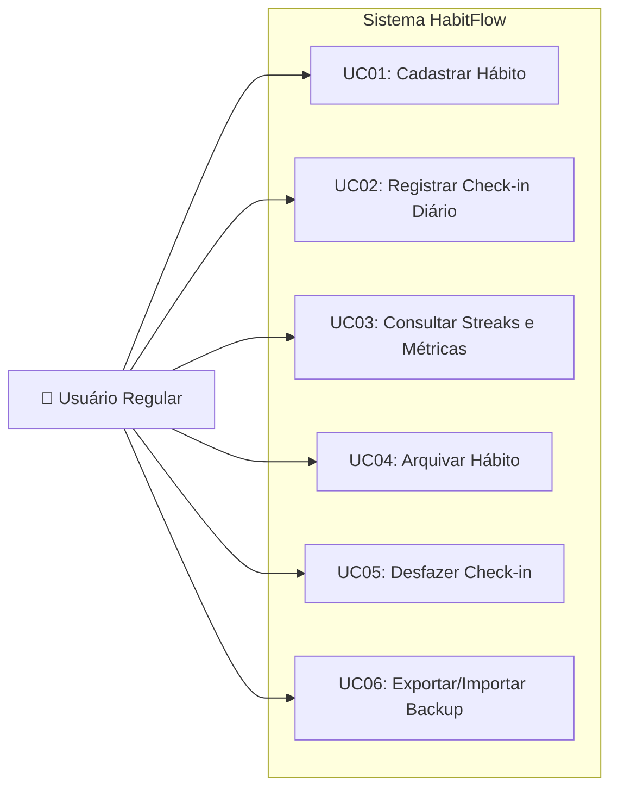

# HabitFlow - Especificação de Casos de Uso (Use Cases)

Este documento descreve os atores do sistema e os fluxos de interação (principais, alternativos e de exceção) para as operações nucleares do **HabitFlow**.

---

## 1. Atores do Sistema

| Ator | Tipo | Descrição |
| :--- | :--- | :--- |
| **Usuário Regular** | Humano (Primário) | Indivíduo que interage com a aplicação para cadastrar hábitos, realizar check-ins diários, monitorar sequências e visualizar relatórios de produtividade. |
| **Sistema HabitFlow** | Automatizado (Secundário) | Núcleo de serviços que processa validações, computa datas, streaks matemáticos, taxas percentuais de adesão e garante a integridade da persistência atômica. |

---

## 2. Diagrama Geral de Casos de Uso

---

## 3. Especificação Detalhada dos Casos de Uso

### UC01: Cadastrar Novo Hábito
- **Ator Principal**: Usuário Regular.
- **Objetivo**: Inserir um novo hábito na rotina do usuário para acompanhamento diário.
- **Pré-condições**: Nenhuma.
- **Pós-condições**: O hábito é persistido no armazenamento com status ativo, zero check-ins e streak inicial zerado.

#### Fluxo Principal
1. O usuário solicita a criação de um hábito informando o título (ex.: "Beber 2L de água").
2. O usuário define opcionalmente a descrição, a categoria (ex.: "Saúde") e a meta semanal de frequência (ex.: 7 dias).
3. O sistema valida os campos obrigatórios e sanitiza as entradas.
4. O sistema gera um identificador único alfanumérico para o hábito.
5. O sistema persiste a entidade com data de criação e status `ativo`.
6. O sistema exibe mensagem de sucesso com os detalhes do hábito cadastrado.

#### Fluxos Alternativos
- **A1: Ausência de Categoria ou Frequência**
  - No passo 2, caso o usuário não informe a categoria ou meta semanal, o sistema aplica os valores default: Categoria `Outros` e frequência de `7` dias por semana. O fluxo retorna ao passo 3.

#### Fluxos de Exceção
- **E1: Título Vazio ou Apenas Espaços em Branco**
  - No passo 3, caso o título esteja ausente ou contenha menos de 3 caracteres, o sistema rejeita a operação com a mensagem de erro `"Erro de Validação: O título do hábito deve conter no mínimo 3 caracteres."`. O caso de uso é encerrado sem persistência.
- **E2: Frequência Alvo Fora do Intervalo Permitido**
  - No passo 3, caso o usuário informe frequência semanal menor que 1 ou maior que 7, o sistema exibe `"Erro: A frequência semanal deve estar entre 1 e 7 dias."`. O caso de uso é encerrado.

---

### UC02: Registrar Check-in Diário
- **Ator Principal**: Usuário Regular.
- **Objetivo**: Confirmar que o hábito selecionado foi executado em determinada data.
- **Pré-condições**: O hábito deve existir e estar com status ativo.
- **Pós-condições**: Registro de check-in associado ao hábito; streaks recalculados; dados persistidos.

#### Fluxo Principal
1. O usuário solicita o check-in indicando o identificador do hábito.
2. O sistema recupera o hábito pelo identificador informado.
3. O sistema obtém a data atual (formato ISO `AAAA-MM-DD`).
4. O sistema verifica se já existe registro de check-in para o hábito na data informada.
5. O sistema registra o novo check-in contendo timestamp exato da conclusão.
6. O sistema aciona o calculador de streaks para atualizar a sequência atual e o recorde histórico.
7. O sistema persiste as alterações no armazenamento durável.
8. O sistema exibe confirmação com a nova contagem de dias da sequência (*streak* atualizado).

#### Fluxos Alternativos
- **A1: Check-in Retroativo (Data Customizada)**
  - No passo 1, o usuário fornece explicitamente uma data passada válida. O sistema processa o check-in para aquela data específica e recalcula os streaks retroativos.

#### Fluxos de Exceção
- **E1: Hábito Não Encontrado**
  - No passo 2, se o ID não corresponder a nenhum hábito, o sistema informa `"Erro: Hábito com ID informado não foi encontrado."`.
- **E2: Hábito Encontra-se Arquivado**
  - No passo 2, se o hábito estiver arquivado, o sistema bloqueia a operação informando `"Erro: Não é possível registrar check-in em um hábito arquivado."`.
- **E3: Check-in Duplicado na Mesma Data**
  - No passo 4, se já houver registro para a data, o sistema impede a duplicação e informa `"Aviso: Este hábito já foi marcado como concluído para o dia [DATA]."`.

---

### UC03: Consultar Streaks e Métricas de Desempenho
- **Ator Principal**: Usuário Regular.
- **Objetivo**: Visualizar o progresso de consistência, dias consecutivos e taxas de conclusão.
- **Pré-condições**: O sistema deve possuir acesso aos dados persistidos.
- **Pós-condições**: Nenhuma alteração de estado no sistema (operação idempotente de leitura).

#### Fluxo Principal
1. O usuário solicita a exibição do painel de métricas.
2. O sistema carrega todos os hábitos ativos e seus respectivos check-ins.
3. Para cada hábito, o sistema executa o algoritmo de cálculo de streaks:
   - Identifica dias consecutivos até o dia corrente ou anterior imediato.
   - Determina se o streak de hoje está ativo ou aguardando conclusão.
   - Avalia a maior sequência histórica contínua de dias registrados.
4. O sistema calcula a taxa de consistência dos últimos 7 dias (`dias_concluídos / 7 * 100%`) e últimos 30 dias.
5. O sistema renderiza a tabela consolidada com títulos, streaks, taxas e status do dia de hoje.

#### Fluxos Alternativos
- **A1: Nenhum Hábito Cadastrado**
  - No passo 2, se a base estiver vazia, o sistema apresenta orientação amigável sugerindo o cadastro do primeiro hábito através do comando de inclusão.

---

### UC04: Arquivar Hábito
- **Ator Principal**: Usuário Regular.
- **Objetivo**: Retirar um hábito de circulação diária sem destruir seu histórico estatístico.
- **Pré-condições**: Hábito existente com status ativo.
- **Pós-condições**: Atributo `isArchived` marcado como `true`; hábito oculto na visualização regular.

#### Fluxo Principal
1. O usuário solicita o arquivamento de um hábito informando o ID.
2. O sistema localiza o registro e verifica seu estado.
3. O sistema altera o campo `isArchived` para `true` e atualiza a data de modificação.
4. O sistema persiste a alteração em disco.
5. O sistema exibe mensagem confirmando que o hábito foi arquivado com sucesso.

#### Fluxos de Exceção
- **E1: Hábito Inexistente ou Já Arquivado**
  - No passo 2, se o ID for inválido ou o hábito já estiver com status arquivado, o sistema emite notificação clara e não realiza alterações.

---

### UC05: Desfazer Check-in (Check-out)
- **Ator Principal**: Usuário Regular.
- **Objetivo**: Cancelar um registro de conclusão feito por engano para a data informada.
- **Pré-condições**: Existência prévia de um check-in registrado para a data alvo.
- **Pós-condições**: Remoção do registro específico de check-in e recálculo imediato das métricas.

#### Fluxo Principal
1. O usuário solicita o cancelamento do check-in para o hábito especificado.
2. O sistema busca os registros de check-in para a data (hoje por padrão).
3. O sistema remove o registro correspondente da lista de check-ins.
4. O sistema recalcula o streak atual e salva os dados atualizados.
5. O sistema exibe feedback de cancelamento realizado.

#### Fluxos de Exceção
- **E1: Inexistência de Check-in para a Data**
  - No passo 2, se não houver conclusão registrada para o dia, o sistema notifica: `"Aviso: Nenhum check-in encontrado para ser desfeito nesta data."`.
