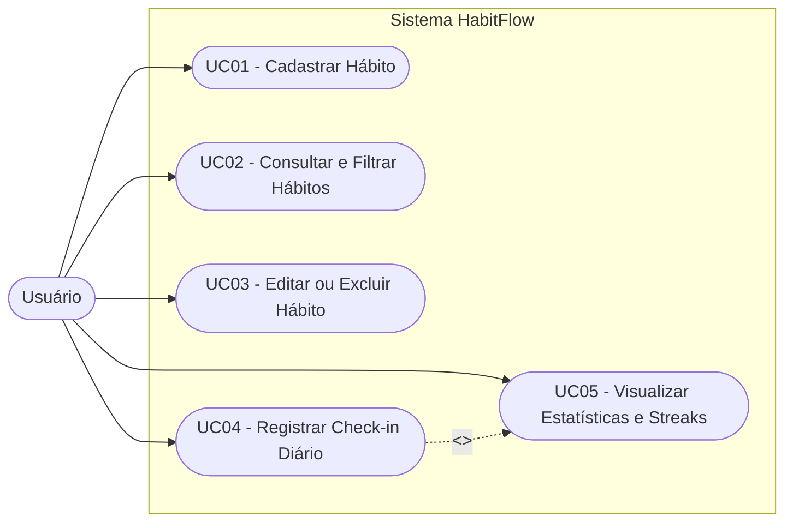

# Especificação de Casos de Uso (Use Cases)

Este documento descreve os atores e especifica detalhadamente os fluxos principais, alternativos e de exceção para as operações centrais do sistema **HabitFlow**.

---

## 1. Descrição dos Atores

| Ator | Tipo | Descrição |
| :--- | :---: | :--- |
| **Usuário** | Primário | Pessoa física (estudante ou profissional) que utiliza o HabitFlow para planejar seus hábitos, registrar *check-ins* diários e acompanhar suas métricas de consistência. |
| **Motor de Estatísticas (Sistema)** | Secundário / Interno | Subsistema responsável por processar o histórico de datas de cada hábito e recalcular em tempo real as ofensivas (*streaks*) e indicadores do dashboard. |

---

## 2. Diagrama Geral de Casos de Uso

---

## 3. Especificação Detalhada dos Casos de Uso

### UC01 — Cadastrar Hábito
- **Ator Principal:** Usuário
- **Requisitos Relacionados:** RF01, RF08
- **Pré-condições:** O sistema deve estar em execução e acessível pelo navegador ou cliente HTTP.
- **Pós-condições:** Um novo hábito é persistido com histórico inicial vazio e exibido na listagem.

#### Fluxo Principal (Caminho Feliz)
1. O Usuário preenche o formulário de novo hábito informando: Título, Descrição, Categoria e Meta Semanal (1 a 7 dias).
2. O Usuário aciona o comando "Adicionar Hábito".
3. O Sistema valida os dados recebidos (RF08).
4. O Sistema gera um identificador único (UUID/ID), define a data de criação e inicializa a lista de *check-ins* vazia.
5. O Sistema persiste o registro no repositório de dados (`data/habits.json`).
6. O Sistema retorna o hábito criado (HTTP 201) e atualiza a listagem e os indicadores na tela.

#### Fluxos Alternativos
- **FA01 — Descrição não informada:**
  1. No passo 1, o Usuário deixa o campo de descrição em branco.
  2. O Sistema aceita o cadastro atribuindo uma string vazia à descrição e prossegue para o passo 3.

#### Fluxos de Exceção
- **FE01 — Título inválido ou ausente:**
  1. No passo 3, o Sistema identifica que o título está vazio ou possui menos de 3 caracteres.
  2. O Sistema rejeita a operação com status `400 Bad Request` e exibe a mensagem: *"O título do hábito é obrigatório e deve ter pelo menos 3 caracteres"*.
  3. O caso de uso retorna ao passo 1.
- **FE02 — Meta semanal fora do intervalo (1 a 7):**
  1. No passo 3, o Sistema detecta que a meta semanal é menor que 1 ou maior que 7.
  2. O Sistema retorna erro `400 Bad Request` informando que a meta semanal deve estar entre 1 e 7 dias.

---

### UC02 — Consultar e Filtrar Hábitos
- **Ator Principal:** Usuário
- **Requisitos Relacionados:** RF02, RF06
- **Pré-condições:** Existir zero ou mais hábitos cadastrados no repositório.
- **Pós-condições:** O usuário visualiza a lista atualizada de hábitos com seus respectivos *streaks*.

#### Fluxo Principal
1. O Usuário acessa a tela inicial do HabitFlow (ou requisita `GET /api/habits`).
2. O Sistema recupera os hábitos armazenados.
3. Para cada hábito, o Motor de Estatísticas calcula a ofensiva atual (*current streak*), o recorde (*best streak*) e se o hábito já foi cumprido na data de hoje.
4. O Sistema apresenta a lista de hábitos ordenada pela data de criação.

#### Fluxos Alternativos
- **FA01 — Filtrar por Categoria ou Busca Textual:**
  1. O Usuário seleciona uma categoria específica (ex.: `Estudos`) ou digita um termo no campo de busca.
  2. O Sistema filtra os registros correspondentes e atualiza a visualização exibindo apenas os itens que atendem ao critério.
- **FA02 — Nenhum hábito cadastrado:**
  1. No passo 2, o Sistema verifica que não há hábitos correspondentes.
  2. O Sistema exibe um estado vazio amigável orientando o usuário a cadastrar seu primeiro hábito.

---

### UC03 — Editar ou Excluir Hábito
- **Ator Principal:** Usuário
- **Requisitos Relacionados:** RF03, RF04, RF08
- **Pré-condições:** O hábito alvo deve existir no sistema.
- **Pós-condições:** Os dados do hábito são atualizados ou o registro é definitivamente removido.

#### Fluxo Principal (Edição)
1. O Usuário seleciona a opção de edição de um hábito existente.
2. O Usuário altera um ou mais campos (título, descrição, categoria ou meta semanal) e confirma.
3. O Sistema valida os novos dados, preserva o array de datas já concluídas (`completedDates`) e salva a alteração.
4. O Sistema retorna status `200 OK` com o hábito atualizado.

#### Fluxos Alternativos
- **FA01 — Exclusão de Hábito:**
  1. O Usuário aciona o botão "Excluir" em um hábito.
  2. O Sistema solicita confirmação da exclusão.
  3. O Usuário confirma a operação.
  4. O Sistema remove o hábito da base de dados, recalcula as estatísticas globais e atualiza a interface.

#### Fluxos de Exceção
- **FE01 — Hábito não encontrado:**
  1. Caso o identificador (ID) informado não exista na base, o Sistema interrompe a operação e retorna `404 Not Found` com a mensagem *"Hábito não encontrado"*.

---

### UC04 — Registrar Check-in Diário (Marcar/Desmarcar Conclusão)
- **Ator Principal:** Usuário
- **Requisitos Relacionados:** RF05, RF06, RF07
- **Pré-condições:** O hábito deve estar cadastrado no sistema.
- **Pós-condições:** A data do *check-in* é adicionada ou removida do histórico do hábito e os *streaks* são recalculados.

#### Fluxo Principal
1. O Usuário clica no botão de *check-in* ("Concluir Hoje") de um hábito listado.
2. O Sistema identifica a data alvo no formato ISO (`YYYY-MM-DD`).
3. O Sistema verifica que a data ainda não consta na lista `completedDates` daquele hábito.
4. O Sistema registra a data no histórico do hábito e persiste a alteração.
5. O Sistema executa o cálculo atualizado de *current streak* e *best streak* (incluindo o **UC05**).
6. O Sistema atualiza o visual do hábito como "Concluído Hoje" e incrementa os indicadores do Dashboard.

#### Fluxos Alternativos
- **FA01 — Desmarcar Check-in (Toggle Off):**
  1. No passo 3, o Sistema verifica que a data informada já está marcada como concluída.
  2. O Sistema remove a data da lista `completedDates` (permitindo corrigir cliques acidentais).
  3. O Sistema recalcula a ofensiva e atualiza a interface desmarcando o hábito.

#### Fluxos de Exceção
- **FE01 — Formato de data inválido:**
  1. Se a requisição à API fornecer uma string de data fora do padrão `YYYY-MM-DD`, o Sistema rejeita a operação com status `400 Bad Request`.

---

### UC05 — Visualizar Estatísticas e Streaks
- **Ator Principal:** Usuário / Motor de Estatísticas
- **Requisitos Relacionados:** RF06, RF07
- **Pré-condições:** Nenhuma.
- **Pós-condições:** As métricas consolidadas de desempenho são apresentadas no painel superior.

#### Fluxo Principal
1. O Usuário visualiza o painel de estatísticas (ou requisita `GET /api/habits/stats`).
2. O Sistema contabiliza o total de hábitos cadastrados e quantos possuem *check-in* na data atual.
3. O Sistema calcula a taxa de conclusão do dia em percentual (`concluidosHoje / totalHabitos * 100`).
4. O Sistema identifica a maior sequência ativa (*current streak*) e o recorde histórico entre todos os hábitos.
5. O Sistema apresenta os cartões de métricas atualizados para o usuário.
